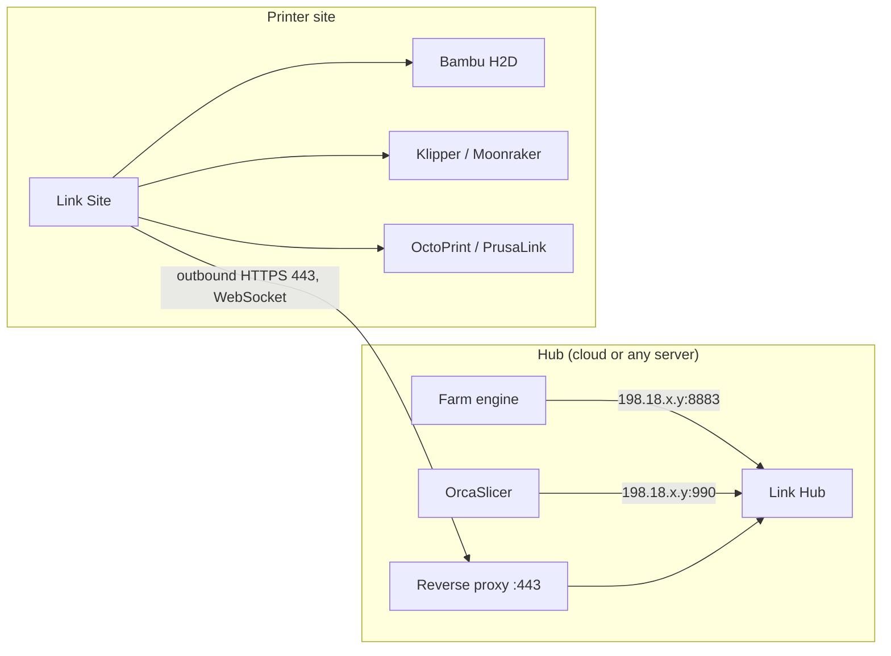

# How OpenPrintHQ Link works

This document describes how Link connects a hub to printers on other networks.
It covers the parts, how a site is paired, how traffic moves, how printers are
found, how the connector is locked down, and how it is packaged and updated.

Words used here:

- **Hub**: an OpenPrintHQ install. It runs the farm, OrcaSlicer, and the rest.
- **Site**: a network with printers on it (a home, a shop, a second shop).
- **Link Hub**: the Link service in the hub's stack.
- **Link Site**: the connector installed on one computer at a site.

## 1. Goals

1. A person who is not technical can connect printers at home to a hub in the
   cloud by installing one program and typing one code.
2. No router, firewall, or DNS changes at the site. No third party accounts.
3. Every printer protocol OrcaSlicer supports keeps working, including
   cameras and file upload.
4. The site connector can only be used by its paired hub, and only to reach
   printers.
5. One hub can serve many sites (a multi-site farm).
6. The connector keeps itself up to date, because it sits on a home network.

## 2. Parts

**Link Hub** is a container in the hub stack. It:

- accepts connections from paired sites on `/link` behind the hub's reverse
  proxy (the same name and certificate as the hub);
- gives every printer a stable address in a private range (the overlay);
- carries any connection the farm or OrcaSlicer makes to an overlay address
  to the right site;
- shows sites and printers in the hub UI, and handles pairing and revoking.

**Link Site** is a single program (written in Go, no runtime to install) that
runs as a system service. It:

- connects out to its paired hub and stays connected;
- finds printers on its network and reports them;
- opens connections to those printers, on their protocol ports only, when the
  hub asks;
- updates itself from signed releases.

## 3. Pairing

Pairing creates trust in both directions with one short code.

1. In the hub (installer or Settings, Printer sites), the owner clicks **Add a
   printer site**. The hub shows a one-time code such as `KX7P-29QD-MV4A`,
   valid for 30 minutes, and a download link for the site connector.
2. The site installer asks for the hub address and the code. (The hub address
   is filled in when the download link carries it.)
3. The site connector makes its own key pair. It sends its public key and the
   code to `https://<hub>/link/pair`. That request is protected by the hub's
   normal public certificate.
4. The hub checks the code, stores the site's public key with the site name,
   and answers with the hub's public key. The code can't be used again.
5. Both sides now hold each other's public keys. Every later connection proves
   both keys, so a stolen code or a copied hub certificate is not enough to
   pose as either side.

Both screens show the same short fingerprint (four groups of hex, worked out
from both public keys) so a careful owner can compare them. The site checks the
hub's fingerprint itself and refuses to pair if they differ. Pairing tries are
limited to 10 per address every 10 minutes. Removing a site in the hub revokes its key at once.

The site's private key is stored where only the service can read it: a file
readable only by its owner in the data folder (`/data` in Docker,
`C:\ProgramData\ArtisanHub Link` on Windows). Moving it to DPAPI and the macOS
System keychain is planned.

## 4. The connection

- The site connects out to `wss://<hub>/link` on port 443. That passes home
  routers, most company firewalls, carrier NAT, and proxies that allow HTTPS.
  It also works when the hub is published through Cloudflare Tunnel.
- Inside the WebSocket the two sides run a Noise IK handshake with their
  pinned keys. Traffic is encrypted end to end between the site and Link Hub,
  even where TLS ends at Cloudflare or the reverse proxy
  (`Noise_IK_25519_ChaChaPoly_BLAKE2s`).
- Over that, yamux carries one stream per printer connection, so many
  connections share one link. Keepalives run every 20 seconds. Limits: 256 open
  streams per site, 32 per printer, and 50 new streams a second per site.
- If the link drops, the site reconnects with backoff and jitter. Printer
  connections in flight end, and the farm's normal reconnect logic takes over.
- One site key may have only one live connection. If a second copy of a site
  connects (for example a cloned VM), the hub keeps the first and marks the
  site "connected twice" in the UI. The prototype showed that without this
  rule two copies knock each other off every few seconds. A second copy is
  refused and the hub's status shows `connected_twice_at`.

## 5. Addresses (the overlay)

Every printer the site reports gets a stable address in a private range on the
hub, for example `198.18.0.4`. The farm and OrcaSlicer use that address like a
LAN address. Link Hub sends anything aimed at it to the right site, which
connects to the printer's real address.

Why addresses instead of ports:

- **Protocols keep working untouched.** Bambu file upload uses implicit FTPS
  with a passive data port chosen by the printer. Python's ftplib and most FTP
  clients connect the data channel to the control connection's address, so
  they reach the overlay address and the data connection follows the same path.
- **Two sites can use the same LAN range.** `192.168.1.50` at home and
  `192.168.1.50` at the shop get different overlay addresses.
- **TLS checks are unchanged.** Bambu and other printers present their own
  certificates; nothing in between terminates TLS.

Details:

- Default range `198.18.0.0/15` (reserved for network testing, so it does not
  collide with home networks, Docker, or Tailscale, which uses
  `100.64.0.0/10`). The installer moves it if the range is already in use.
- Addresses are kept per site and printer serial (or MAC address when there is
  no serial) and survive restarts in `/data/state.json`. Removing a site frees
  its addresses.
- Link Hub owns the range with an iptables redirect in its own network
  namespace. The hub host gets one route for the range pointing at the Link Hub
  container. The installer adds that route with a short privileged helper at
  start, which works the same on Linux and inside Docker Desktop's VM on
  Windows and macOS. No other container needs extra rights.
- Printers added by hand, by IP, get an overlay address the same way.

## 6. Finding printers

Discovery runs at the site, because discovery traffic (broadcast and
multicast) can't cross the internet. Each finding is checked before it is
reported: the protocol port must answer. The prototype showed why: the mDNS
library passed on answers from TVs and NAS boxes that are not printers.

| Family | How it is found | Ports allowed |
| --- | --- | --- |
| Bambu Lab (X1, P1, A1, H2D, H2C, H2S) | SSDP announcements on UDP 2021 and an SSDP search on UDP 1990 | 8883 MQTT, 990 FTPS, 322 RTSPS camera, 6000 camera, passive FTPS data ports for 60 s after a 990 connection |
| Klipper with Moonraker (Voron, Creality K series rooted, many others) | mDNS `_moonraker._tcp`, plus a probe of port 7125 | 7125, 80, 443, 8080 (web UI and webcam) |
| OctoPrint | mDNS `_octoprint._tcp` | 80, 443, 5000, 8080 (mjpg streamer) |
| Prusa with PrusaLink (MK4, MK4S, Core One, XL, MINI) | Probe of `/api/version` on port 80 (PrusaLink's mDNS name is not documented; to be confirmed on hardware) | 80, 443 |
| Elegoo SDCP (Centauri Carbon, Saturn, Mars) | UDP 3000 broadcast `M99999` | 3030 WebSocket, 8080 camera |
| Duet / RepRapFirmware | mDNS `_http._tcp` with Duet in the name, plus a probe of `/rr_model` | 80 |
| Anything else OrcaSlicer reaches over TCP | Added by hand with IP and family | Family's list |

The site sends its full list every 30 seconds and whenever it changes. A
printer missing from the list shows as offline in the hub.

## 7. Hardening the site connector

The site connector is a door into a home network, so it is narrow by design:

- **No inbound ports from the internet.** It only connects out. The one thing
  it listens for is printers announcing themselves (SSDP and mDNS), and on
  Windows its firewall rule admits that from the local subnet only.
- **Only the paired hub.** Both keys are checked on every connection. Unknown
  keys are dropped before any stream opens.
- **Only printers.** The hub asks for "printer address, port". The site
  refuses any address it did not discover or the owner did not add, any address
  outside private ranges, and any port not on that family's list. Bambu passive
  FTPS ports open for 60 seconds after a control connection to that printer,
  and only to that printer.
- **TCP only.** No UDP, no raw packets, no routing of other traffic.
- **Limits.** A cap on streams per printer and per site, and on connection
  rate, so a compromised hub can't use the site to flood the LAN.
- **Local log.** Every refused request is logged at the site with the reason.
- **Least privilege at run time.** Installing needs administrator rights (it is
  a system service). The service itself drops to a dedicated account on Linux
  and macOS and runs as a virtual service account on Windows.

Proved in the prototype: SSH on a printer, a non-printer address, and an
unknown overlay address were all refused.

## 8. Updates

Auto-update is on by default and can be turned off in the installer or in the
hub UI, per site.

- The connector checks the hub's release feed (GitHub Releases) once a day.
- A release is installed only when both checks pass: the operating system
  signature (Authenticode on Windows, Developer ID on macOS, repository key on
  Linux) and a separate Ed25519 signature made with the Link release key, whose
  public half is built into the connector.
- The new version starts, connects to the hub, and reports healthy within two
  minutes, or the old version is put back.
- The hub can pause updates for all sites, and shows each site's version. A
  release can be marked as a security release, which the hub highlights.
- Docker sites update by image tag. The installer can run Legacy farm-style
  pulls for the Link image only, or leave it to the owner.

Updates never open anything inbound. The connector fetches releases the same
way it reaches the hub, with an outgoing HTTPS request.

## 9. Packaging and signing

| Platform | Package | Signing |
| --- | --- | --- |
| Windows x64 and Arm64 | MSI with the service registered | SignPath Foundation (free for open source), approved by hand for each release |
| macOS Intel and Apple silicon | One universal pkg, launchd daemon | Developer ID Application (binary) and Developer ID Installer (pkg), notarized and stapled |
| Linux amd64 and arm64 | .deb, .rpm, systemd unit; apt and dnf repository | Repository key |
| Docker amd64 and arm64 | ghcr.io/norjms/openprinthq-link | Cosign signature |

Windows installers show "SignPath Foundation" as the publisher: the project
signs through the SignPath Foundation's open source program, which issues the
certificate to the foundation and checks that each file was built from this
repository by its release workflow. That program does not allow commercial
dual-licensing, so Link stays AGPL-3.0-only. See
[CODE_SIGNING.md](../CODE_SIGNING.md).

The installer on every platform asks for the hub address and pairing code,
and offers the auto-update choice. On Docker the same values are environment
variables.

## 10. In the OpenPrintHQ installer

During the hub install, when the hub is not on the same network as the printers
(or the owner says some printers are elsewhere), the installer asks:

> **Are any of your printers on a different network from this hub?**
> For example, the hub runs in the cloud and the printers are at home, or you
> run printers at more than one place. OpenPrintHQ Link connects them safely
> without changing your router. You install a small program on one computer
> that stays on at each place with printers.

If yes, the installer:

1. adds Link Hub to the stack and publishes `/link` on the hub's name (through
   Cloudflare Tunnel when the hub is home-only);
2. after install, shows **Add a printer site** with the download link to the
   latest site connector for the person's platform, and the pairing code;
3. asks whether the site connectors should keep themselves updated (on by
   default), with a note that updates fix security problems and never open
   ports.

More sites can be added later from Settings.

## 11. Multi-site farms

Each site has its own key, name, and printers. The farm shows the site next to
each printer. Overlay addresses come from one range, so printer addresses never
clash across sites. A site that goes offline marks only its own printers
offline.

## 12. Replacing the OpenPrintHQ client app and broker

Link replaces the OpenPrintHQ client app and its broker as the way a farm
reaches printers on another network. That covers OpenPrintHQ Farm, a hosted
farm, and OpenPrintHQ run on its own.

What changes:

- **One program at each site.** Link Site is the only thing installed at a
  printer site. The client app is no longer needed there.
- **The farm talks to printers directly.** The farm engine already speaks each
  printer's protocol (Bambu MQTT and FTPS, Moonraker, OctoPrint, PrusaLink).
  It now uses the printer's overlay address instead of a relay. Nothing at the
  site runs farm commands; it only carries a printer's own protocol to a port
  on that printer's list.
- **Command signing moves out of the site.** The client app needed signed
  commands because it acted on the farm's behalf. Link Site acts on nothing, so
  the risk is covered by pairing and the port lists instead. Printer
  credentials (Bambu access codes, OctoPrint and PrusaLink keys) stay in the
  farm, as on a local network.
- **Cameras go through the hub.** go2rtc in the hub reads each camera at its
  overlay address and serves it to the browser and the apps from the hub. The
  broker's direct browser to client connection is not needed.
- **No broker service.** There is nothing to run between the hub and the site
  except the hub's own address. Hosted farms reach their customers' printers
  the same way.

Moving an existing site:

1. Install Link Site at the site and pair it with the hub.
2. The farm matches printers it already knows to the ones Link reports, by
   serial number (Bambu) or by address, and switches each to its overlay
   address. Print history, files and spools are kept.
3. Uninstall the client app. When no site uses it, the broker is turned off.

## 13. License

AGPL-3.0-only, the same license as the hub and the farm.

## 14. Open questions

1. PrusaLink discovery on a real MK4S, the Voron's Moonraker, and Elegoo
   discovery on hardware.
2. Whether Link Hub should also expose a status API to Home Assistant.
